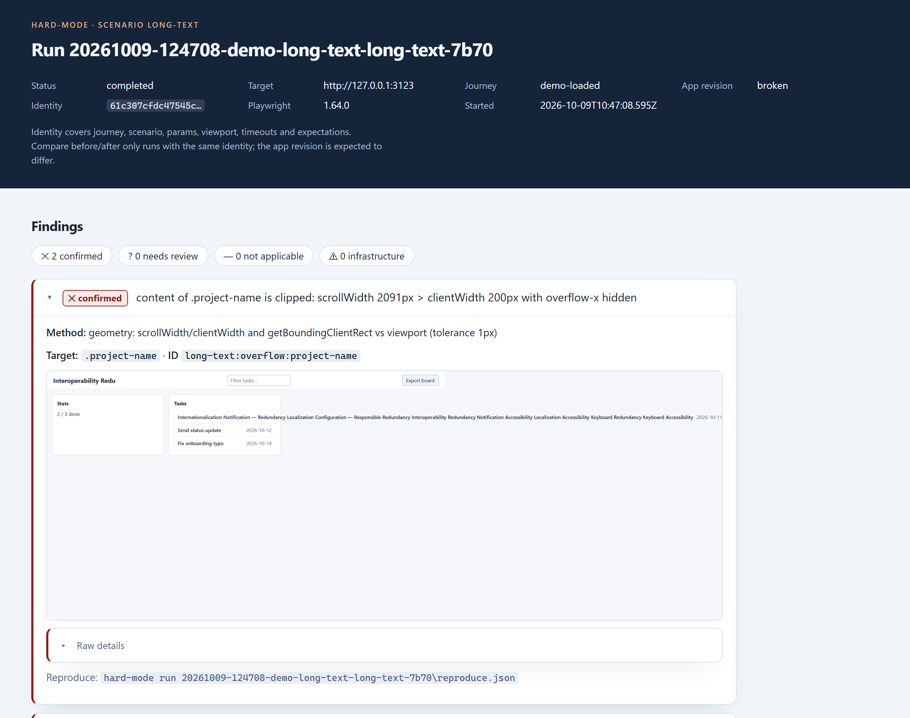
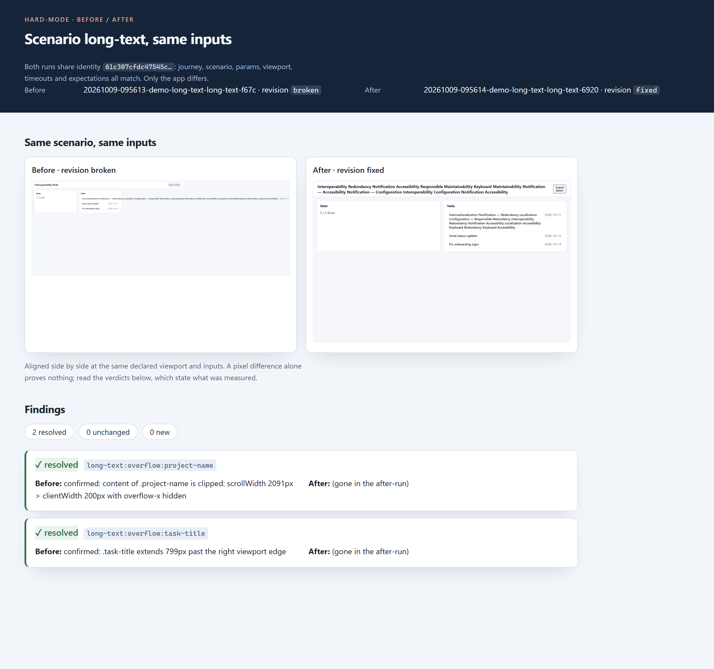

# Hard Mode

> Your beautiful demo meets real life.

hard-mode is a local testing tool for web apps. A Playwright runner drives your running app through five uncomfortable but ordinary situations, records what happens, and keeps the evidence: screenshots, pixel measurements, focus traces. When you fix something, you rerun the exact same configuration and get a before/after comparison.

Everything runs on your machine. The runner never edits your app's code and sends nothing anywhere.



That is a real report from `npm run demo`: a synthetic app whose header clips long titles and whose "Export" control is a `div`, so keyboard users can never reach it. The report says what was measured, not what to feel about it. Fix the app, rerun the identical config, and the comparison tells you what changed:



## The five scenarios

| scenario | what it does |
| -------- | ------------ |
| `long-text` | replaces text at selectors you choose with deterministic long text, then measures clipping and overflow geometry |
| `narrow-viewport` | narrow viewport plus root font-size scaling. A layout probe, not a device emulator |
| `empty-data` | answers one selected API route with a valid but empty response you configure |
| `slow-network` | delays or fails one selected request, within a bounded window |
| `keyboard` | walks the tab order and checks whether a control you name can be reached by keyboard |

Every run opens a clean browser context and closes it even when things fail. Findings come in four types, and the report tells you which is which: `confirmed` means a measurable condition was violated, `needs_review` means something looked off but the intent is unclear, `not_applicable` means the scenario never applied, and `infrastructure_error` means the harness itself could not run (server down, budget exceeded) and says nothing about your app.

## Quick start

Requirements: Node.js 20 or later.

```bash
git clone <this repo> && cd hard-mode
npm install
npm run build
npx playwright install chromium
npm run demo
```

The demo runs a scenario against the broken build of the synthetic app, applies the fix, reruns the identical config, and prints where the report and the comparison landed. You can pass any scenario id: `npm run demo keyboard`.

## Using it on your own app

Start your app locally, then write a run config: a base URL, a short journey (navigate, wait for something observable), one scenario and its params. The full schema lives in [`skills/hard-mode/references/runconfig.md`](skills/hard-mode/references/runconfig.md).

```bash
node dist/cli.js validate my-config.json   # check the config before running
node dist/cli.js run my-config.json        # writes runs/<id>/report.html
node dist/cli.js runs                      # list runs with status and counts
node dist/cli.js scenarios                 # list scenarios and their params
```

After fixing your app, rerun the same config with a new revision label and compare. Comparison is refused unless both runs share the same journey, scenario, params, viewport, timeouts and expectations; only the app is allowed to change.

```bash
node dist/cli.js run my-config.json --revision "after-fix"
node dist/cli.js compare runs/<before> runs/<after>   # exit 3 if identities differ
```

Exit codes: `0` run completed, `1` invalid usage or config, `2` infrastructure error such as an unreachable server, `3` compare refused.

Since the package is on npm, the CLI also works without cloning anything (one-time per machine: `npx playwright install chromium`):

```bash
npx hard-mode scenarios
npx hard-mode run my-config.json
```

## Using it from any harness

The CLI is the stable interface, so every agent that can run shell commands can drive hard-mode. What varies is how the agent learns the workflow:

| harness | how |
| ------- | --- |
| Claude Code (verified) | copy `skills/hard-mode/` into `.claude/skills/`; the skill carries the whole workflow |
| any terminal, human or CI (verified) | the `npx hard-mode ...` commands above |
| Cursor, Codex CLI, Gemini CLI, opencode (untested conventions) | point the harness's rule file (`AGENTS.md`, `.cursor/rules/`, `GEMINI.md`) at the skill, or paste the plain-contract prompt |

Copy-paste snippets for each one, with an honest account of what is verified: [`skills/hard-mode/references/harnesses.md`](skills/hard-mode/references/harnesses.md).

## The agent skill

`skills/hard-mode/` contains an installable skill that teaches an agent this workflow: pick a target with a verifiable goal, write and validate the config, run the CLI, read findings as signals rather than verdicts, reproduce a finding before proposing a fix, and rerun the identical config after the fix. Point your agent at the skill folder, or copy it wherever your agent looks for skills. The CLI is the stable interface; the skill needs no other plugins.

## Development

```bash
npm run typecheck   # TypeScript for src and tests
npm test            # build plus the full suite (unit and browser e2e)
npm run demo        # end-to-end demo on the synthetic app
node scripts/ci-dry-run.mjs   # run the CI steps on a pristine checkout
```

The suite covers every scenario against a broken control and a fixed control (no invented findings), the full journey vocabulary (fill, press, expect hidden/text/url, role and text selectors, nth injections), multiple simultaneous route fixtures, automatic scenario budgets for long delays, reproduction from a saved config, comparison with identity checks, infrastructure-error classification, HTML escaping of hostile app text, an axe accessibility audit of the report itself, keyboard operability and narrow-screen behavior, and a second sample app with a completely different structure.

The screenshots above come from the synthetic demo apps (`fixtures/demo-app`, `fixtures/second-app`), which ship with deliberately `broken` and `fixed` builds served from the same URLs. No real user data is involved anywhere.

## Scope and limits

- Local execution, local output. No telemetry, accounts, or billing.
- The narrow-viewport scenario changes layout width and font size. It does not simulate a phone, browser zoom, or screen density.
- The keyboard scenario records focus order and reachability. It is not an accessibility audit.
- Point it at local or test apps only, never at production or payment flows.

## License

MIT. See [LICENSE](LICENSE).
